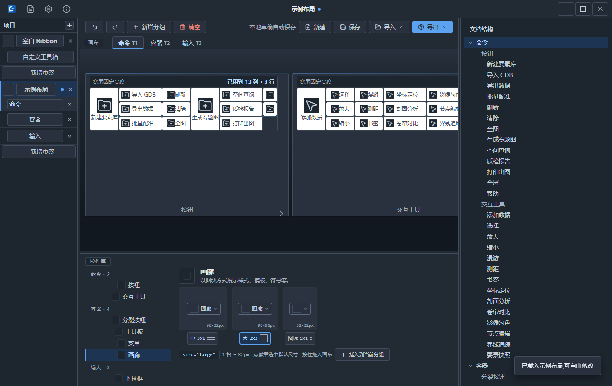
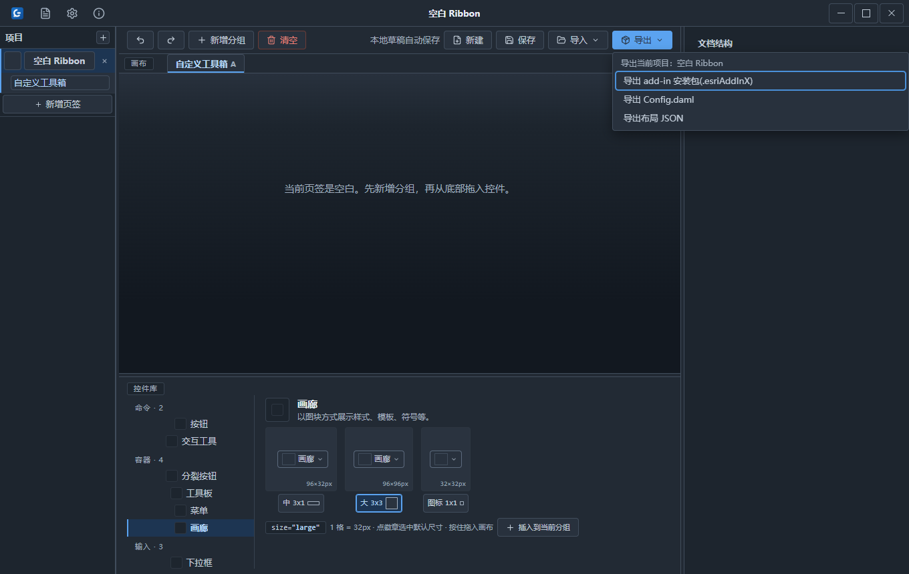
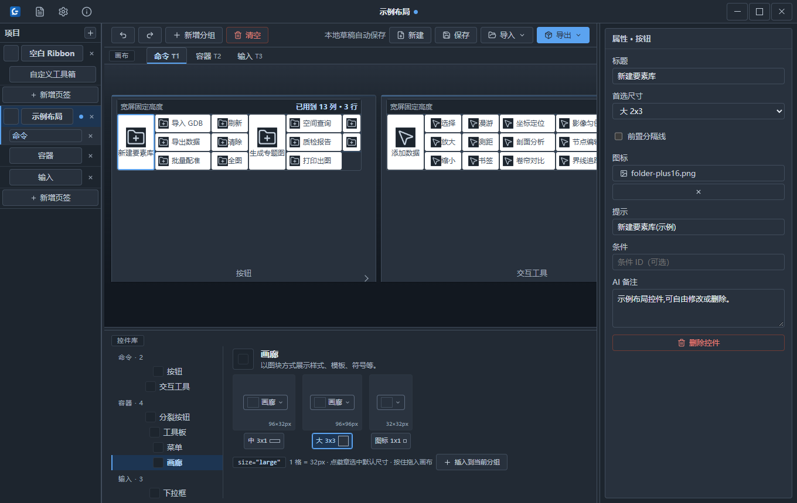
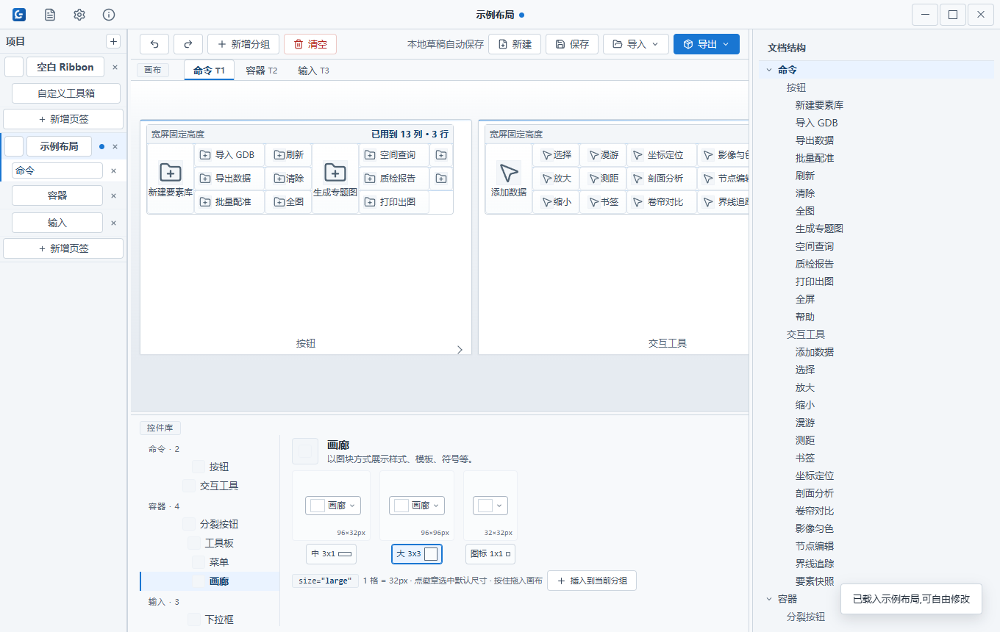
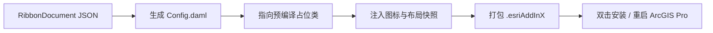
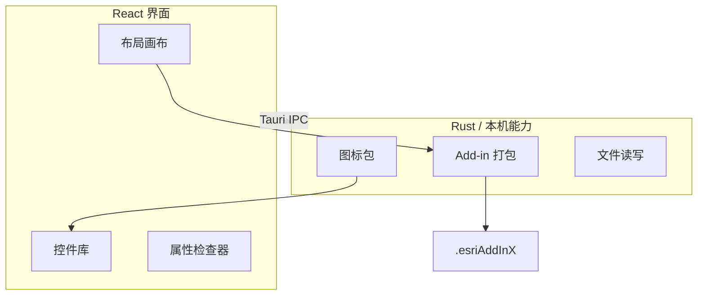

**QQ 交流群：826861025**

<div align="center">
  
  <h1>极思G Ribbon 设计器</h1>
  <p>拖出 ArcGIS Pro Ribbon，一键打包成 Add-in</p>
  <p>
    <a href="https://github.com/edcfoshan/arcgis-pro-addin-layout-agent/releases"></a>
    
    
    <a href="./LICENSE"></a>
  </p>
</div>

## ❤️ 赞助商

<a href="https://jizhanai.top/register?ref=PBUXGDHTFUAS">
  
</a>

<table>
  <tr>
    <td width="24%" align="center">
      <a href="https://jizhanai.top/register?ref=PBUXGDHTFUAS"></a>
    </td>
    <td>感谢 <a href="https://jizhanai.top/register?ref=PBUXGDHTFUAS"><b>极栈 · jizhanai.top</b></a> 赞助支持本项目！极栈提供 <b>ChatGPT 会员充值</b>服务，支持<b>支付宝支付</b>。选购 <b>ChatGPT 激活码</b>后，按站内指引前往码港兑换。<br><br>通过<a href="https://jizhanai.top/register?ref=PBUXGDHTFUAS">邀请链接注册开通</a>，填写邀请码 <code>PBUXGDHTFUAS</code>，可减 <b>5 元</b>。</td>
  </tr>
</table>



## 30 秒看懂

**极思G Ribbon 设计器**面向测绘、国土和 GIS 二开人员：不用先学 DAML，也不用安装 Visual Studio、.NET SDK 或 ArcGIS Pro SDK，直接在可视化画布中拖出 Ribbon 分组和控件，再一键导出 `.esriAddInX`。

它解决的问题很集中：传统 ArcGIS Pro Add-in 界面调试依赖开发环境和反复编译；只想确认“按钮放在哪个页签、哪个分组、占多大位置”时，成本太高。这个 Demo 把布局设计前置到桌面画布里，先把结构和观感定下来。

> 当前是 `0.1.0-demo.2` 社区预览版。它只解决 **Ribbon 布局**；导出的按钮是界面占位，不包含真实业务命令。

## 下载安装

到 [GitHub Releases](https://github.com/edcfoshan/arcgis-pro-addin-layout-agent/releases/latest) 下载安装包。

| 文件 | 用途 | 说明 |
| --- | --- | --- |
| `JisigG-Ribbon-Designer_0.1.0-demo.2_x64-setup.exe` | Windows 安装版 | 按当前用户安装，无需管理员权限 |
| `JisigG-Ribbon-Designer_0.1.0-demo.2_x64-setup.exe.sig` | 更新签名文件 | 应用内检查更新时使用 |
| `latest.json` | 更新元数据 | 由 Release 工作流生成 |

双击安装后，从开始菜单打开「极思G Ribbon 设计器」。应用内置「关于 → 检查更新」，后续版本可从应用内跳转升级。安装包使用 ASCII 文件名，是为了保持 GitHub 资产名和更新签名链稳定；应用内显示名仍是中文。

## 三步上手

| 步骤 | 操作 | 你会得到 |
| --- | --- | --- |
| 1 | 新增项目、页签和分组 | 一条 3 行高的 Ribbon 分组网格 |
| 2 | 从控件库选择类型和尺寸，插入或拖入画布 | 与 ArcGIS Pro 占格一致的按钮、工具、容器或输入控件 |
| 3 | 点击「导出 → 导出 add-in 安装包」 | 可双击安装的 `.esriAddInX` |



首次使用可以直接打开「示例布局」，也可以在文件菜单中新建空白 Ribbon。画布支持网格吸附和碰撞检测：空间不足时会拒绝放置，避免导出一个 Pro 里必然挤压的布局。

## 功能矩阵

| 模块 | 当前能力 | 状态 |
| --- | --- | --- |
| 布局画布 | 项目 / 页签 / 分组管理，网格吸附、碰撞检测、横向扩列 | Demo 可用 |
| Ribbon 控件 | 按钮、交互工具、分裂按钮、工具板、菜单、画廊、下拉框、输入框、复选框 | Demo 可用 |
| 控件尺寸 | 大 / 中 / 小形态，部分类型支持图标形态 | Demo 可用 |
| 属性检查器 | 标题、尺寸、提示、条件、AI 备注、分隔线和图标 | Demo 可用 |
| 图标库 | 内置约 5100 个 Tabler Icons，支持中文搜索和自定义 PNG | Demo 可用 |
| 文件能力 | 新建、打开、保存、另存为、最近文件、示例布局 | Demo 可用 |
| 撤销重做 | 每个项目独立撤销 / 重做，栈深 50 | Demo 可用 |
| 导出 | 生成 `.esriAddInX`、`Config.daml`、布局 JSON | 布局可导出；业务动作为空 |
| 主题 | 浅色 / 暗色界面 | Demo 可用 |
| 命令绑定 | 生成真实事件处理代码或绑定业务逻辑 | 未包含 |



## 核心能力详解

### 1. 先把 Ribbon 结构画出来

左侧管理项目和页签，中部画布按 ArcGIS Pro 的 Ribbon 网格组织控件，右侧检查器维护标题、提示和图标。分组固定 3 行高，可按需横向扩列；控件位置按 32px 网格吸附。

这意味着你可以先和业务人员确认页签命名、分组顺序、按钮密度和图标观感，再进入真正的命令开发。布局返工发生在设计器里，而不是 ArcGIS Pro 的编译调试循环里。



### 2. 九类控件，按 Pro 的空间语言占格

不是简单把按钮排成网格。设计器按 ArcGIS Pro 的实际观感建模：大按钮占满 3 行，分裂按钮保留下拉箭头区域，画廊按图块展开，输入类控件保留标签和输入框宽度。

| 控件类型 | 小 | 中 | 大 | 适用场景 |
| --- | --- | --- | --- | --- |
| 按钮 Button | `1x1` | `2x1` | `2x3` | 单个命令入口 |
| 交互工具 Tool | `1x1` | `2x1` | `2x3` | 地图点选、框选、测距等交互 |
| 分裂按钮 SplitButton | - | `2x1` | `2x2` | 主命令加一组相关动作 |
| 工具板 ToolPalette | - | `3x1` | `3x3` | 常用绘图 / 编辑工具组 |
| 菜单 Menu | `1x1` | `2x1` | `2x2` | 收纳一组子命令 |
| 画廊 Gallery | - | `3x1` | `3x3` | 样式、模板、符号库 |
| 下拉框 ComboBox | - | `3x1` | `4x1` | 选择图层、字段或预设 |
| 输入框 EditBox | - | `3x1` | `4x1` | 输入关键词、容差或路径 |
| 复选框 CheckBox | `1x1` | `2x1` | - | 开关显示项或行为 |

> 以 `1 格 = 32px × 32px` 建模，分组高 3 行。表中的占格用于 Demo 阶段的布局验收，最终以 ArcGIS Pro 实测为准。

### 3. 免编译导出 `.esriAddInX`

导出时，设计器把可视化文档转换成 ArcGIS Pro 能识别的 Add-in 包；用户机器不需要安装 .NET SDK 或 Esri Pro SDK。



导出包中的控件统一指向预编译占位类，因此能看到界面、图标、提示和布局，但点击后不会执行真实业务命令。这个边界是刻意保留的：本版本先解决布局成型和沟通确认，命令绑定在后续里程碑处理。

### 4. 图标、文案和检查器一起定稿

每个控件可以在检查器里维护标题、tooltip、条件 ID 和 AI 备注；图标支持内置 Tabler Icons 中文搜索，也支持上传自定义 PNG。这样导出前就能检查三类问题：

| 检查项 | 常见问题 | 设计器里的处理 |
| --- | --- | --- |
| 布局 | 控件挤压、分组过宽、尺寸不统一 | 网格占格、碰撞检测、列宽控制 |
| 文案 | 标题过长、提示缺失、命名不一致 | 检查器统一维护标题与提示 |
| 图标 | 分辨率不足、大小 / 小图缺失 | 16 / 32px 图标选择与自定义上传 |

## Demo 边界

| 项目 | 当前说明 |
| --- | --- |
| 业务命令 | 不生成事件处理代码，导出控件点击后无动作 |
| 插件生命周期 | 不处理业务初始化、数据连接和权限逻辑 |
| 兼容承诺 | 先按实测 ArcGIS Pro 环境收集反馈，不承诺所有版本 |
| 文档格式 | JSON、DAML 和导出包结构仍可能调整 |
| 生产交付 | 不建议直接承担正式项目交付 |

## 质量与测试

| 检查 | 命令 | 守护内容 |
| --- | --- | --- |
| TypeScript | `cd designer-app && npx tsc --noEmit` | 界面类型和图标兜底 props |
| Rust / 权限白名单 | `cd designer-app/src-tauri && cargo test --lib --test capabilities_test` | 图标解析、文件名安全和 updater/process 权限 |
| UI 机械验收 | `cd tools/ui-check && npm ci && npm run check` | 15 项布局、停靠、拖拽和键盘可达性 |
| Node 逻辑 | `cd tools/ui-check && npm run check:node` | Add-in ID 稳定性与 DAML 分组顺序 |

## 技术架构

| 层 | 技术 | 职责 |
| --- | --- | --- |
| 桌面壳 | Tauri 2 | 窗口、文件对话框、更新器和本机资源 |
| 前端 | React 19 + TypeScript + Vite | 画布、控件库、检查器和主题 |
| 后端 | Rust | 图标包读取、文件打包、导入导出 |
| 图标 | Tabler Icons | MIT 协议，构建期生成 16 / 32px 图标包 |
| 导出 | 预编译占位 Add-in | 免编译生成 `.esriAddInX` |



## 从源码构建

需要 Node.js 20+ 和 Rust 工具链。

```powershell
# 1. 生成图标包
cd tools/icon-gen
npm ci
node gen-png.mjs

# 2. 构建桌面应用
cd ../../designer-app
npm ci
npm run tauri build
```

日常调试和验证：

```powershell
cd designer-app
npm run tauri dev          # 启动桌面应用
npx tsc --noEmit           # TypeScript 检查

cd src-tauri
cargo test --lib           # Rust 单元测试
```

## 仓库结构

| 目录 | 说明 |
| --- | --- |
| `designer-app/` | Tauri 2 + React 19 桌面设计器主线 |
| `designer-app/src/core/` | 布局、网格、碰撞和 DAML 生成逻辑 |
| `designer-app/src-tauri/` | Rust 后端、资源与打包配置 |
| `tools/icon-gen/` | Tabler Icons 图标包生成器 |
| `tools/placeholder-addin/` | 免编译导出使用的占位 Add-in 源码 |
| `tools/tabler-icons/` | vendored Tabler Icons SVG 源 |
| `arcgis-pro-validation/` | 开发侧装机验算插件 |
| `docs/` | 发布说明、指南和架构决策记录 |
| `designer-app/src-tauri/tests/` | 集成测试，包括能力白名单回归 |

## 社区反馈

| 场景 | 入口 |
| --- | --- |
| 安装失败、崩溃、布局导出缺陷 | [GitHub Issues](../../issues) |
| 工作流建议、界面和交互讨论 | [GitHub Discussions](../../discussions) |
| 一般交流 | QQ 交流群：826861025 |

提交问题时请尽量附上 ArcGIS Pro 版本、Windows 版本、设计器版本、操作步骤和脱敏截图。

## 关注与赞赏

扫码关注「极思G工作室」公众号、加入 QQ 交流群，获取工具更新、交流使用经验：


如果这些工具对你有帮助，欢迎赞赏支持。赞赏完全自愿，感谢你的支持。


## License

[MIT](./LICENSE)

内置图标来自 [Tabler Icons](https://github.com/tabler/tabler-icons)，使用 MIT 协议。ArcGIS 和 ArcGIS Pro 是 Esri 的商标；本项目与 Esri 无隶属关系。
